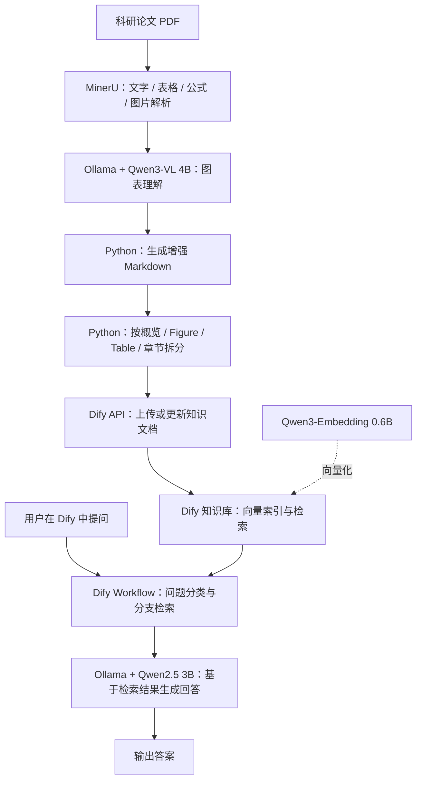

# 本地 OCR + RAG 科研论文知识库问答系统

基于 **MinerU + Ollama + Qwen + Dify + Python**，实现科研论文 PDF 的自动解析、图表理解、结构化知识库构建和本地大模型问答。

> **当前状态：** 核心流程已经跑通，并完成单篇论文的初步验证；原文精准引用、多论文稳定性和完整增量同步仍需进一步完善。

## 一、项目简介与整体流程

### 1. 项目实现什么

用户只需把论文 PDF 放入指定目录并运行 `main.py`，程序便会自动提取论文内容、理解图表、拆分知识文档并同步至 Dify。入库完成后，用户直接在 Dify 的 Workflow 中提问，无须反复运行 Python。

### 2. 系统流程图



**两条独立流程：**

- **文档入库：** `PDF → MinerU → Qwen3-VL → Python 结构化 → Dify 知识库`，由 `main.py` 执行。
- **知识问答：** `问题 → Dify Workflow → 知识检索 → Qwen2.5 → 回答`，在 Dify 页面执行。

### 3. 技术组件与作用

| 组件 / 模型 | 在本项目中的作用 |
| --- | --- |
| **MinerU 4.x** | 将 PDF 转换为 Markdown、表格、公式、图片及结构化信息 |
| **Ollama** | 在本机运行并管理 Qwen 模型 |
| **Qwen3-VL 4B** | 读取图片和统计图中的标签、数值与可见结构 |
| **Qwen3-Embedding 0.6B** | 将知识库文本向量化，用于语义检索 |
| **Qwen2.5 3B** | 根据检索到的论文内容生成回答 |
| **Dify 1.17.1** | 管理知识库、建立索引、配置检索与问答 Workflow |
| **Python** | 串联各组件，负责缓存、结构化拆分和 API 自动入库 |

**与最初设想的差异：** 受本机 **16GB 内存、6GB 显存**限制，暂用 Qwen 系列模型替代 `deepseek-r1:14b`；使用 **Dify 自带的 RAG 能力**，暂未单独部署 RAGFlow，也未使用 LangChain。


## 二、系统架构

### 1. 项目文件结构（主要文件及功能）

```text
OCR_RAG_question_answering-system/
│
├─ main.py                         # 唯一日常入口：处理 PDF、调用各模块、入库
├─ README.md                       # 本说明文档
├─ .gitignore                      # Git 忽略规则
│
├─ ocr_rag_pipeline/              # OCR + 图表理解 + 入库核心代码
│  ├─ __init__.py                 # Python 包初始化
│  ├─ mineru.py                   # 调用 mineru-kit，把 PDF 解析为 ZIP
│  ├─ archive.py                  # 解压并校验 MinerU ZIP
│  ├─ metadata.py                 # 提取图片类型、页码等元数据
│  ├─ visual.py                   # 调用 Ollama / Qwen3-VL 分析图片
│  ├─ markdown.py                 # 将原文、图注、视觉描述合并为 Markdown
│  ├─ pipeline.py                 # 协调 OCR、图片处理、缓存、日志
│  ├─ knowledge.py                # 拆分知识文档，调用 Dify API 上传/更新/索引
│  └─ utils.py                    # 文件哈希、路径、日志等公共工具
│
├─ data/
│  ├─ input/                      # 【用户输入】放待处理论文 PDF
│  └─ output/                     # 【程序生成】处理结果和缓存
│     ├─ pipeline/
│     │  └─ 论文名_文件哈希/
│     │     ├─ mineru_output.zip  # MinerU 原始解析结果
│     │     ├─ mineru.log         # MinerU 执行日志
│     │     ├─ pipeline.log       # OCR / 图表识别日志
│     │     ├─ visual_analysis.json # 图像识别状态、结果统计
│     │     ├─ vision_cache.json  # 已成功识别图像的缓存（运行后生成）
│     │     └─ parsed/
│     │        ├─ markdown.md           # 原始 MinerU Markdown
│     │        ├─ enhanced_markdown.md  # 加入视觉信息后的 Markdown
│     │        ├─ images/               # 提取出来的图表 / 图片
│     │        └─ knowledge/
│     │           ├─ manifest.json     # 结构化文档清单
│     │           └─ part_XX.txt       # 待上传 Dify 的各份知识文档
│     └─ rag_v2_state/            # Dify 文档 ID / 内容哈希 / 同步状态
│
├─ tests/                         # 自动化代码测试
│  ├─ test_stage1.py
│  └─ test_unified.py
└─  OCR_RAG_QA_V2_Dify_1.17.yml	#导入dify的workflow
```

说明：`data/output/` 中的文件由程序根据论文生成，**不一定每个子目录都同时存在**。请勿随意删除缓存和 `rag_v2_state/`，否则可能影响断点续跑及文档同步判断。


### 2. 知识库如何组织

为避免整篇论文直接分块造成图、表与正文混在一起，Python 先将增强 Markdown 拆成四类文档：

| 文档类型 | 内容与用途 |
| --- | --- |
| **OVERVIEW** | 摘要、引言、结论等原文证据；用于回答论文主要贡献 |
| **FIGURE_XX** | 独立 Figure 的图注、可见数据、视觉描述；用于图表定向检索 |
| **TABLE_XX** | 独立 Table 的表题和表格数据；减少不同表格混淆 |
| **SECTION_XX** | 按章节和段落组织的正文；用于方法、数据集、实验等问题 |

示例论文 *Joint Image and Text Representation for Aesthetics* 生成了 **22 份文档**：概览 1、Figure 5、Table 2、章节正文 14。其他论文的数量由内容决定。

Dify 使用 **`OCR_RAG_V2` 高质量索引**，Embedding 为 `qwen3-embedding:0.6b`。程序通过 Dify API 创建或更新文本知识文档，并等待索引完成。**目前检索的是文字和图表的文字描述，并非直接对图片二进制做视觉检索。**


### 3. Dify 问答 Workflow 架构

```text
Dify Workflow（已有的 V2 应用，约 15 个节点）
│
├─ 开始：输入用户问题
│   ↓
├─ 问题路由
│   ├─ Figure / Table 问题 ──→ 图表精确检索 ──────────┐
│   └─ 其他问题 ──→ 综合问题判断                       │
│                    ├─ 方法与创新检索 ────────────────┤
│                    ├─ 数据集与资源检索 ──────────────┤
│                    ├─ 实验与结论检索 ────────────────┤
│                    └─ 常规混合检索 ──────────────────┤
│                                                    ↓
├─ 整理 / 合并检索证据（全部检索节点连接 OCR_RAG_V2）
│   ↓
├─ LLM：Qwen2.5 3B，根据证据回答
│   ↓
└─ 结束：输出答案
```

注意：**`main.py` 只负责入库，不会自动创建 Dify Workflow。** 当前上传的源码 ZIP **未包含**该 Workflow 的 DSL（`.yml`）导出文件；要在另一套 Dify 上原样复现，需额外导出并导入 DSL，再绑定知识库与模型。


## 三、实际环境与部署配置

### 1. 当前运行环境

| 项目 | 实际配置 |
| --- | --- |
| 系统 / IDE | Windows / PyCharm |
| 内存 / 显卡 | 16GB RAM / RTX 3060 Laptop（6GB VRAM） |
| Python | Miniforge **base**，Python `3.14.7` |
| Python 路径 | `D:\AI\miniForge1\python.exe` |
| 项目路径 | `D:\AI\projects\OCR_RAG_question_answering-system` |
| MinerU | 4.x，使用 `mineru-kit` 命令 |
| Ollama | `0.40.11`，`http://localhost:11434` |
| Dify | `1.17.1`，本地 Docker，`http://localhost:8080` |

**模型名称（实际使用）：**

```text
qwen3-vl:4b-instruct      # 图表理解，Python → Ollama
qwen3-embedding:0.6b      # 向量化，Dify → Ollama
qwen2.5:3b                # 问答生成，Dify → Ollama
```


### 2. 环境检查（在 PyCharm 下方 Terminal / PowerShell 中执行）

**① Python、MinerU 与 Python 依赖：**

```powershell
& "D:\AI\miniForge1\python.exe" --version
Get-Command mineru-kit -ErrorAction SilentlyContinue
& "D:\AI\miniForge1\python.exe" -m pip show requests
```

预期：Python 版本正确、能找到 `mineru-kit`、已安装 `requests`。若**仅缺 `requests`**，在现有 base 环境安装：

```powershell
& "D:\AI\miniForge1\python.exe" -m pip install requests
```


**② Ollama 服务与模型：**

```powershell
ollama --version
ollama list
ollama ps
```

`ollama list` 中应包含上述三款模型。缺少哪款才下载哪款：

```powershell
ollama pull qwen3-vl:4b-instruct
ollama pull qwen3-embedding:0.6b
ollama pull qwen2.5:3b
```


**③ Docker 与 Dify：**

```powershell
docker ps
```

在浏览器访问 `http://localhost:8080`，确认 Dify 页面可打开；如打不开，先在 **Docker Desktop** 中检查 Dify 容器是否启动。


### 3. Dify 必要配置（首次部署或核查）

1. **模型接入**：进入 Dify → **设置 → 模型供应商（Model Provider）**，配置 Ollama，确保 `qwen3-embedding:0.6b` 和 `qwen2.5:3b` 可用。Dify 在 Docker 内访问 Windows 上的 Ollama，通常使用 `http://host.docker.internal:11434`，不能直接把容器的 `localhost` 当作宿主机。
2. **知识库**：进入 **知识库**，使用 `OCR_RAG_V2`；索引模式为**高质量**、文本 Embedding 为 `qwen3-embedding:0.6b`、文档为通用文本分块模式。结构化文档的具体分段规则由 Python API 上传时指定。
3. **Workflow**：进入 **工作室（Studio）**，新建 V2 问答应用，直接导入`OCR_RAG_QA_V2_Dify_1.17.yml`，来创建workflow。 然后确认**全部 5 个知识检索节点**已绑定 `OCR_RAG_V2`，问答模型为 `qwen2.5:3b`。
4. **API 访问**：在 Dify 的知识库 API 相关页面取得 Service API Key，并获取目标知识库 ID。**只需首次配置，日常无需重填。**

程序使用的 **Windows 用户环境变量**：

```text
DIFY_API_KEY   = Dify 知识库 Service API Key
DIFY_V2_ID     = <your-dify-knowledge-base-id>
DIFY_API_BASE  = http://localhost:8080/v1    （可选，默认就是此地址）
```

`DIFY_V2_ID` 为**当前这套 Dify 实例**的知识库 ID；在其他实例新建知识库后，应使用**新实例的真实 ID**，不可直接沿用。检查变量是否设置（不显示密钥）：

```powershell
[bool]([Environment]::GetEnvironmentVariable('DIFY_API_KEY', 'User'))
[bool]([Environment]::GetEnvironmentVariable('DIFY_V2_ID', 'User'))
```

均输出 `True` 即用户变量存在；是否有效以实际 API 入库为准。**不要将 Key 写入 README 或公开仓库。**

> **新电脑部署说明：** 本仓库是应用代码，不包含完整的 Docker Compose 配置和 Dify Workflow DSL，也不会自动安装 MinerU / Ollama / Dify。因此，新电脑需先分别部署这些服务，再导入 Workflow 和配置知识库；当前电脑可直接按以上步骤检查，无须重装。


## 四、详细使用步骤

### 步骤 1：确认服务已启动

确保 **Ollama 正常运行、Docker Desktop 中的 Dify 已启动**，且浏览器能访问 `http://localhost:8080`。只有首次部署时才需要配置模型、知识库和 API Key。

### 步骤 2：放入论文 PDF

将要处理的论文复制到：

```text
D:\AI\projects\OCR_RAG_question_answering-system\data\input\
```

可放一篇或多篇；默认会处理该文件夹下的**全部 PDF**。

### 步骤 3：运行一键入库

在 **PyCharm → 下方 Terminal**，执行：

```powershell
cd D:\AI\projects\OCR_RAG_question_answering-system
& "D:\AI\miniForge1\python.exe" .\main.py
```

程序自动完成：

1. **MinerU 解析** PDF（如已有相同 PDF 的有效缓存，则复用）。
2. **Qwen3-VL 识别图片 / 图表**，将可见信息补充到 Markdown（已成功图片可按缓存复用；已经完整转成文字的表格不重复识别）。
3. **结构化拆分**概览、Figure、Table、章节正文。
4. **调用 Dify API** 创建或更新文档、等待索引完成，并执行默认召回自测。

终端重点看以下信息：

```text
[OCR] 已完成且 PDF 未变化，复用 ...      # 重复处理时可能出现
结构化：22 份文档（图 5、表 2、正文 14、概览 1）
[1/22] 上传/更新 ...
...
✅ Dify 入库完成：新建 X、更新 Y、跳过已存在 Z
```

上例的 **22 份仅对应测试论文**。如果提示失败，根据 `data/output/pipeline/` 中对应论文的 `mineru.log`、`pipeline.log` 或 `visual_analysis.json` 排查，**不要先删除已有结果或重跑全部 OCR**。

### 步骤 4：在 Dify 检查知识库

浏览器打开 `http://localhost:8080` → **知识库 → OCR_RAG_V2**，确认新生成的概览、Figure、Table 和章节文档已出现，且**索引完成**。

### 步骤 5：在 Dify 提问

打开 **工作室（Studio）→ 已建好的 V2 问答 Workflow → 预览/运行**，输入问题，例如：

```text
Figure 3 中四种方法的准确率分别是多少？
这篇论文的主要贡献是什么？请分别说明方法、数据集和实验结果。
```

已测试论文的 Figure 3 能回答 `78.40% / 78.51% / 78.64% / 78.88%`，最高为 **Joint Hidden（78.88%）**；综合问答也已初步通过。**目前最终回答的 PDF 精确页码与引用仍未稳定实现，重要数字应对照原论文核实。**

> **入库一次即可多次提问**；只有增加或修改 PDF、重新构建知识库时才需要再运行 `main.py`。


### 常用命令与本地测试

以下命令都在项目根目录的 PowerShell / PyCharm Terminal 执行：

```powershell
# 只处理指定论文
& "D:\AI\miniForge1\python.exe" .\main.py --pdf ".\data\input\Joint image and text representation for aesthetics.pdf"

# 只生成本地 OCR / 结构化结果，不上传 Dify
& "D:\AI\miniForge1\python.exe" .\main.py --prepare-only

# 处理其他论文时，不执行针对示例论文的三道召回自测
& "D:\AI\miniForge1\python.exe" .\main.py --skip-smoke

# 确需重新执行 MinerU 时使用（不要作为日常默认命令）
& "D:\AI\miniForge1\python.exe" .\main.py --force-ocr

# 运行本地单元测试
& "D:\AI\miniForge1\python.exe" -m unittest discover -s tests -v
```

源码中的 **9 项自动化测试**已通过，覆盖解析流程组织、缓存、分块和异常处理等；这些测试使用模拟服务，不能代替真实的 MinerU/Ollama/Dify 集成测试。


## 五、后续提升方向

1. **原文引用与可追溯性**：给检索片段关联 PDF 页码、Figure/Table 编号与原文位置，使回答可核查。
2. **检索策略研究（主要科研切入点）**：对比“普通分块 vs 图表/章节结构化分块”“单路检索 vs 分类多路检索”，评估召回率与回答准确率。
3. **多论文评测**：增加不同排版、扫描件、复杂表格和公式论文，建立问答测试集，统计图表识别错误与最终问答效果。
4. **增量同步与稳定性**：验证重复运行时是否真正跳过不变的 Dify 文档；完善异常重试、断点恢复和失败日志。
5. **项目可复现交付**：补充 Dify Workflow DSL、部署配置与关键测试截图，清理不必要的历史文件；**移除 ZIP 中的 `key.txt`，轮换曾暴露的密钥**。

**项目定位：** 目前是可运行的本地 OCR + 结构化 RAG 问答原型；下一阶段重点从“功能跑通”转向“检索与回答效果的可量化改进”。
